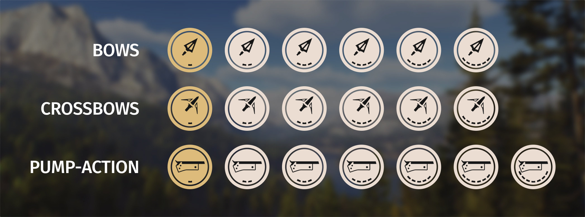
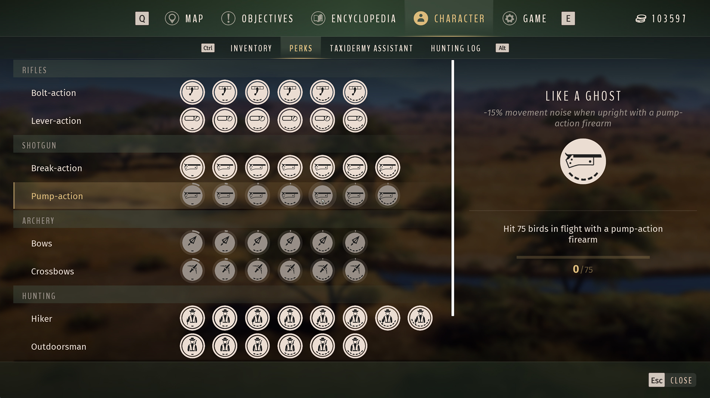
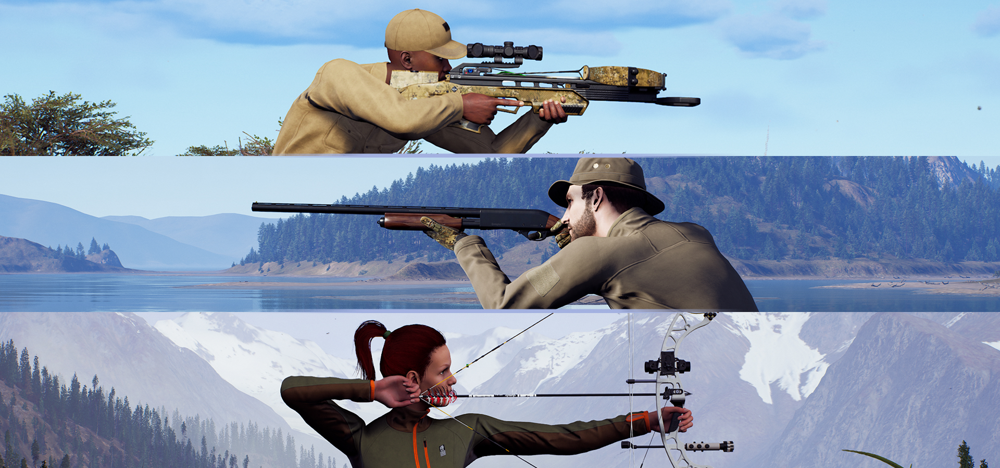

# Weapon Skill Expansion — Way of the Hunter Mod

By Mahpella

Adds 19 progression skills for bows, crossbows, and pump-action weapons in Way of the Hunter, with separate saved progress and equipment-specific bonuses.

## Overview

Specializing in bows, crossbows, or pump-action weapons has limited support in the original weapon progression menu. Weapon Skill Expansion gives these hunting styles dedicated branches, challenges, and bonuses, so using your preferred equipment contributes to long-term progression. Each new branch saves its own progress independently of the original skills.

## Download & Install

### Step 1. Create a backup (optional)

If you wish, copy the Saved folder to another location:  
**Win + R → %LOCALAPPDATA%\WayOfTheHunter**

### Step 2. Open the game folder

Close the game. In Steam, browse the local files for Way of the Hunter and open:  
**WayOfTheHunter\Content\Paks**

### Step 3. Install the mod

Extract the archive and copy all **.pak files into the Paks folder**, replacing older versions if necessary.  
Launch the game and load your save.

## How to Use

- Open Character > Abilities.
- Find Bow and Crossbow under Archery, and pump-action skills under Shotguns.

- Read each skill's unlock requirements and use the matching weapon group to make progress.
- Track the separate saved counters in the new branches.
- Equip the relevant weapon to receive its unlocked bonuses.
- Archery tier five reduces crouched movement noise by 15%; pump-action tier five reduces upright movement noise by 15% while holding the matching weapon.

## Feedback

If you find a bug, have suggestions for improving this mod, or have ideas for new mods, I would love to hear from you.

More useful interface and UX mods at my website: [https://mahpella.com](https://mahpella.com)

If you would like to support my work →  
[Buy Me a Coffee](https://buymeacoffee.com/mahpella) or [PayPal.me](https://paypal.me/bymahpella)

